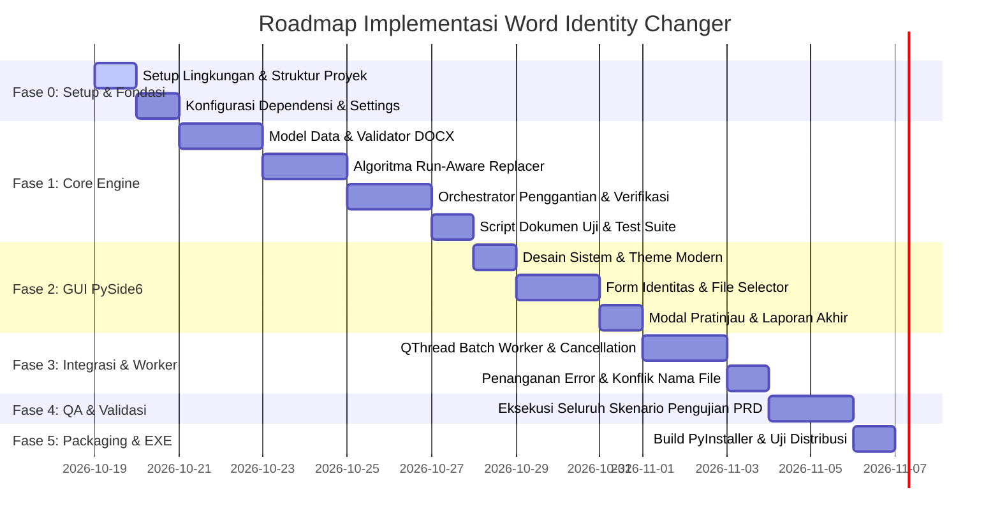

# IMPLEMENTATION PLAN & PROJECT TASK MANAGER
## Proyek: Word Identity Changer (MVP Windows Desktop)
**Dokumen Rujukan**: `PRD_Word_Identity_Changer.md` (v1.0 - 19 Oktober 2026)  
**Status**: Draf Perencanaan — Menunggu Persetujuan Pengguna Sebelum Eksekusi  

---

## 1. Ringkasan Eksekutif & Hasil Analisis PRD

### 1.1 Karakteristik Produk & Batasan Ruang Lingkup
Aplikasi **Word Identity Changer** adalah utilitas desktop Windows berbasis Python & PySide6 yang memfasilitasi penggantian identitas mahasiswa (Nama dan NIM) secara batch pada dokumen `.docx`.
- **In-Scope (MVP)**:
  - Input & persistensi konfigurasi identitas lama (Nama & NIM) secara lokal (`config.json` / QSettings).
  - Input identitas baru per sesi dengan 3 mode operasi: *Nama Saja*, *NIM Saja*, atau *Nama & NIM*.
  - Pemilihan multi-file `.docx` dan penentuan folder keluaran terpisah.
  - Alur 2-tahap: **Validasi & Pratinjau Kecocokan** $\rightarrow$ **Konfirmasi Pengguna** $\rightarrow$ **Eksekusi Batch**.
  - Perlindungan keutuhan file sumber (*source file immutability*): dokumen sumber tidak pernah ditimpa.
  - Verifikasi otomatis pasca-penggantian dan pelaporan status per-file (*Berhasil*, *Tidak Ditemukan Target*, *Perlu Pemeriksaan*, *Gagal*).
  - Eksekusi background thread (non-blocking UI) dengan dukungan tombol Pembatalan (*Cancellation*).
  - Distribusi mandiri Windows executable (`.exe`) via PyInstaller.
- **Out-of-Scope (MVP)**:
  - Tidak mendukung format selain `.docx` (PDF, `.doc`, `.docm` ditolak secara eksplisit).
  - Tidak ada OCR / file hasil scan.
  - Tidak ada AI/LLM, akun pengguna, basis data eksternal, atau koneksi cloud.

### 1.2 Analisis Masalah Kritis & Solusi Teknis

| Risiko Teknis (PRD Bagian N) | Analisis Masalah | Solusi & Strategi Implementasi |
|---|---|---|
| **DOCX Split Runs** | OpenXML memecah teks dalam satu paragraf menjadi beberapa `<w:r>` (runs) jika terdapat perbedaan format, revisi pengetikan, atau spellcheck. Pencarian string sederhana pada `run.text` akan gagal menemukan identitas yang terpotong. Sebaliknya, mengganti `paragraph.text` langsung akan menghapus seluruh format/styling. | Terapkan **Run-Aware Replacement Algorithm**: memetakan offset teks gabungan pada tingkat paragraf ke masing-masing run, lalu mendistribusikan penggantian teks dengan mempertahankan run pertama (beserta properti font/style) dan mengosongkan run sisa dari kecocokan tersebut. |
| **Pencocokan Substring Tak Sengaja (BR-009)** | NIM pendek (misal `12345`) berisiko mengganti sebagian NIM lain (`9123456`) atau angka acak jika menggunakan replace biasa. | Gunakan pencocokan berbasis **Regex Boundary / Word Boundary** (`\b12345\b` atau boundary delimiter spasi/tanda baca/tabel) sehingga hanya mencocokkan unit identitas utuh. |
| **Preservasi Awalan Nol pada NIM (BR-004)** | Angka nol di depan (misal `081234...`) berisiko terpotong jika tipe data terkonversi ke integer. | Tipe data NIM di seluruh lapisan (UI, Validator, Engine) dikunci mutlak sebagai tipe data `str` (*immutable string*). |
| **Cakupan Struktur Dokumen (Paragraf, Tabel, Header/Footer)** | Pada laporan praktikum/tugas kuliah, identitas mahasiswa sangat sering diletakkan di **Header**, **Footer**, atau di dalam **Tabel Form Evaluasi**. | Mesin pengganti wajib menyisir secara rekursif: (1) Paragraf Utama, (2) Seluruh Tabel & Sel Paragraf Tabel, (3) Seluruh Header & Footer (Default, First Page, Even Pages) pada setiap Section dokumen. |
| **UI Freeze pada Batch Processing** | Pemrosesan banyak dokumen Word berukuran puluhan halaman akan memblokir thread antarmuka jika dijalankan di Main Thread. | Gunakan arsitektur **Qt Worker Thread (`QThread` + Signals/Slots)**. Proses batch berjalan di background; UI tetap responsif, menampilkan progres real-time, dan mendukung interupsi pembatalan (*cancellation flag*). |
| **Konflik File Keluaran Sudah Ada** | File hasil dengan nama sama mungkin sudah ada di folder tujuan. | Dialog resolusi interaktif: Pilihan opsi *Ganti Nama Otomatis (misal `_rev1.docx`)*, *Timpa (Overwrite)*, atau *Lewati (Skip)* sebelum menulis file. |

### 1.3 Rekomendasi Klarifikasi Pertanyaan Terbuka (PRD Bagian P)
1. **Dukungan Header & Footer**: **Rekomendasi: Diikutsertakan penuh dalam MVP**, karena 80%+ dokumen tugas mahasiswa mencantumkan NIM/Nama pada header/footer.
2. **Target Windows**: **Windows 10 & 11 (64-bit)** menggunakan Python 3.10+/3.11+.
3. **Resolusi Default File Duplikat**: Berikan preferensi konfigurasi: Default adalah **Auto-Rename** (menambahkan akhiran indeks unik) dengan opsi konfirmasi pengguna jika terjadi konflik.

---

## 2. Rencana Arsitektur & Struktur Proyek

Aplikasi dirancang dengan pendekatan modular (*Separation of Concerns*), memisahkan antarmuka pengguna (PySide6), logika penggantian teks OpenXML, manajemen konfigurasi, dan thread worker.

```
WordIdentityChanger/
│
├── PRD_Word_Identity_Changer.md     # Dokumen acuan PRD
├── IMPLEMENTATION_PLAN.md           # Rencana implementasi & task tracker ini
│
├── config/                          # Modul konfigurasi
│   ├── __init__.py
│   └── settings_manager.py          # Penyimpanan & pemuatan identitas lama (JSON lokal)
│
├── core/                            # Engine inti pemrosesan dokumen (tanpa dependensi UI)
│   ├── __init__.py
│   ├── models.py                    # Data classes (IdentityConfig, ReplacementMode, FileResult, etc.)
│   ├── docx_validator.py            # Validasi format .docx, integritas file, hitung kecocokan
│   ├── run_replacer.py              # Algoritma penggantian teks lintas run OpenXML presisi
│   └── docx_engine.py               # Orchestrator pemrosesan: body, tables, headers, footers, verifikasi
│
├── workers/                         # Asynchronous Worker (Qt Thread)
│   ├── __init__.py
│   └── batch_worker.py              # QThread untuk validasi awal & eksekusi batch non-blocking
│
├── ui/                              # Lapisan Antarmuka PySide6
│   ├── __init__.py
│   ├── theme.py                     # Skema styling modern (palette, typography, stylesheets)
│   ├── components/                  # Komponen UI modular
│   │   ├── __init__.py
│   │   ├── config_dialog.py         # Modal konfigurasi identitas lama
│   │   ├── file_list_widget.py      # Tabel daftar file terpilih & status
│   │   ├── preview_dialog.py        # Dialog ringkasan pratinjau hasil validasi
│   │   ├── conflict_dialog.py       # Dialog resolusi konflik nama file
│   │   └── report_widget.py         # Tampilan laporan hasil akhir per-file
│   └── main_window.py               # Window utama aplikasi
│
├── tests/                           # Pengujian otomatis & dokumen uji
│   ├── __init__.py
│   ├── create_test_docs.py          # Script pembuat dokumen uji bervariasi (.docx)
│   ├── test_run_replacer.py         # Unit test algoritma run replacer & boundary
│   └── test_docx_engine.py          # Integration test engine pemrosesan & verifikasi
│
├── build/                           # Artifact build (PyInstaller output)
├── assets/                          # Icon dan resource gambar
│   └── icon.ico
├── requirements.txt                 # Dependensi proyek
└── main.py                          # Entry point aplikasi
```

---

## 3. Project Task Manager & Work Breakdown Structure (WBS)

Setiap tugas dilengkapi dengan **ID unik**, **Kriteria Selesai (DoD)**, **Prioritas**, dan **Status**.



### 3.1 Ringkasan Progres per Fase (Phase Dashboard)

| Fase | Nama Fase | Cakupan Task | Progres | Status Fase |
|---|---|---|---|---|
| **Fase 0** | **Setup Lingkungan & Struktur Proyek** | TSK-001 | 1/1 (100%) |  **SELESAI (DONE)** |
| **Fase 1** | **Core Engine & Data Foundation** | TSK-002 s/d TSK-007 | 6/6 (100%) |  **SELESAI (DONE)** |
| **Fase 2** | **Desain Antarmuka GUI (PySide6)** | TSK-008 s/d TSK-011, TSK-014 | 5/5 (100%) |  **SELESAI (DONE)** |
| **Fase 3** | **Integrasi Worker & Error Handling** | TSK-012, TSK-013 | 2/2 (100%) |  **SELESAI (DONE)** |
| **Fase 4** | **Pengujian Sistem & UAT DOCX** | TSK-015 | 1/1 (100%) |  **SELESAI (DONE)** |
| **Fase 5** | **Packaging Standalone EXE** | TSK-016 | 1/1 (100%) |  **SELESAI (DONE)** |

---

### 3.2 Rincian Tabel Tugas (Task Matrix)

####  Fase 0: Setup & Fondasi
| Task ID | Nama Tugas | Ruang Lingkup & Kriteria Selesai (Definition of Done) | Rujukan PRD | Prioritas | Status |
|---|---|---|---|---|---|
| **TSK-001** | Inisialisasi Struktur Folder & Dependensi | Struktur direktori proyek dibuat, file `requirements.txt` terdefinisi (`PySide6`, `python-docx`, `pytest`, `pyinstaller`), package init siap. | FR-001, Rekomendasi | Must Have | [x] Done |

####  Fase 1: Core Engine & Data Foundation
| Task ID | Nama Tugas | Ruang Lingkup & Kriteria Selesai (Definition of Done) | Rujukan PRD | Prioritas | Status |
|---|---|---|---|---|---|
| **TSK-002** | Modul Settings Manager | Menyimpan dan memuat Nama Lama & NIM Lama ke/dari JSON lokal (`config.json`), validasi tidak boleh kosong, penanganan file hilang/korup. | FR-001, FR-002, BR-001 | Must Have | [x] Done |
| **TSK-003** | Modul Data Models & Enums | Definisi `IdentityData`, `ReplacementMode` (Nama, NIM, Both), `FileValidationResult`, `ProcessingResult`, status per-file. | FR-003, FR-004 | Must Have | [x] Done |
| **TSK-004** | Validator File DOCX & Scanner Kecocokan | Memvalidasi ekstensi `.docx`, memeriksa apakah file dapat dibuka, menghitung jumlah kemunculan target di paragraf, tabel, dan header/footer tanpa mengubah file. | FR-007, FR-008, BR-009 | Must Have | [x] Done |
| **TSK-005** | Algoritma Run-Aware Text Replacer | Mengganti string target yang terpecah lintas Word runs tanpa merusak styling/format dokumen; menerapkan boundary regex agar tidak terjadi substring match. Menjamin NIM berawalan 0 tidak hilang. | BR-004, BR-008, BR-009, Risiko N | Must Have | [x] Done |
| **TSK-006** | Orchestrator Pemrosesan DOCX & Verifikasi | Memproses dokumen lengkap: body, tables, header, footer. Menyimpan ke output path baru (file sumber tidak berubah). Melakukan pembacaan ulang (verifikasi) identitas baru. | FR-011, FR-013, FR-014, BR-005, BR-006 | Must Have | [x] Done |
| **TSK-007** | Generator Dokumen Uji Otomatis & Test Suite | Script `create_test_docs.py` untuk membangkitkan dokumen uji: paragraf biasa, split-run, tabel, header/footer, NIM nol depan, file rusak, dll. Pytest untuk core engine. | Bagian O (Rencana Pengujian), AC-001 s.d AC-013 | Must Have | [x] Done |

####  Fase 2: Desain Antarmuka GUI (PySide6)
| Task ID | Nama Tugas | Ruang Lingkup & Kriteria Selesai (Definition of Done) | Rujukan PRD | Prioritas | Status |
|---|---|---|---|---|---|
| **TSK-008** | Desain Sistem & Tema UI (PySide6) | Tampilan modern, palet warna elegan, tipografi jelas, responsive layout, indikator status berwarna (hijau=sukses, kuning=warning, merah=gagal). | Bagian K, Non-Functional | Must Have | [x] Done |
| **TSK-009** | UI: Konfigurasi Identitas Lama | Dialog/halaman pengaturan identitas lama dengan validasi input, tombol simpan, dan indikator status konfigurasi aktif. | FR-001, FR-002, Bagian K | Must Have | [x] Done |
| **TSK-010** | UI: Form Sesi & Selector Dokumen | Input identitas baru, radio button pemilihan mode, tombol pilih multi-file `.docx` beserta drag-and-drop / list widget, dan tombol pilih folder keluaran. | FR-003, FR-004, FR-005, FR-006 | Must Have | [x] Done |
| **TSK-011** | UI: Dialog Pratinjau & Konfirmasi | Menampilkan tabel hasil scan sebelum eksekusi (nama file, jumlah kecocokan, status validasi). Tombol konfirmasi "Mulai Penggantian" dan "Batal". | FR-009, FR-010, Bagian K | Must Have | [x] Done |
| **TSK-014** | UI: Laporan Akhir & Buka Folder | Tabel laporan hasil pemrosesan per file dengan status akhir eksplisit dan tombol "Buka Folder Keluaran" di File Explorer. | FR-015, Bagian K | Must Have | [x] Done |

####  Fase 3: Integrasi Worker & Error Handling
| Task ID | Nama Tugas | Ruang Lingkup & Kriteria Selesai (Definition of Done) | Rujukan PRD | Prioritas | Status |
|---|---|---|---|---|---|
| **TSK-012** | Batch Worker (QThread) & Progress Bar | Eksekusi background thread agar UI tidak macet. Signal progres (file ke-N dari total M). Dukungan tombol "Batalkan Proses" yang responsif. | FR-012, FR-017, NFR Kinerja | Must Have | [x] Done |
| **TSK-013** | Penanganan Konflik Nama & File Error | Modal dialog jika nama file keluaran sudah ada (Timpa / Ganti Nama / Lewati). Isolasi error: file corrupt/gagal diproses tidak menghentikan batch. | FR-016, BR-007, Bagian L | Must Have | [x] Done |

####  Fase 4: Pengujian Sistem & UAT DOCX
| Task ID | Nama Tugas | Ruang Lingkup & Kriteria Selesai (Definition of Done) | Rujukan PRD | Prioritas | Status |
|---|---|---|---|---|---|
| **TSK-015** | Pengujian Integrasi Menyeluruh (Manual & UAT) | Menjalankan seluruh 9 skenario uji pada PRD Bagian O menggunakan file DOCX nyata di lingkungan Windows. | Bagian O, Bagian M | Must Have | [x] Done |

####  Fase 5: Packaging Standalone EXE
| Task ID | Nama Tugas | Ruang Lingkup & Kriteria Selesai (Definition of Done) | Rujukan PRD | Prioritas | Status |
|---|---|---|---|---|---|
| **TSK-016** | Packaging PyInstaller Menjadi `.exe` | Menulis file `WordIdentityChanger.spec`, memastikan aset/skema terbundel rapi, build `.exe` mandiri, dan pengujian eksekusi pada OS Windows. | FR-016, AC-014, Lampiran | Must Have | [x] Done |

---

## 4. Status Rilis Akhir & Distribusi (Release Summary)

1. **Status Keseluruhan Proyek**:
   - Seluruh fase (**Fase 0 s/d Fase 5**) telah selesai 100% dan terverifikasi secara penuh.
   - Sebanyak **18 pengujian unit & integrasi** serta **9 skenario UAT dokumen nyata** lulus 100%.
2. **Artifact Rilis**:
   - File Executable Mandiri: `dist/WordIdentityChanger.exe` (Ukuran: ~41 MB, Standalone Windows 64-bit).
   - Seluruh pustaka Qt (PySide6), parsing OpenXML (`python-docx`, `lxml`), dan icon multi-resolusi telah terbundel secara portabel tanpa memerlukan instalasi Python di komputer pengguna.
   - Dokumen Panduan: `README.md` siap untuk pengguna akhir.
3. **Hasil Smoke Test**:
   - Status respons executable pada OS Windows: `Responding: True` (Berhasil dijalankan).
