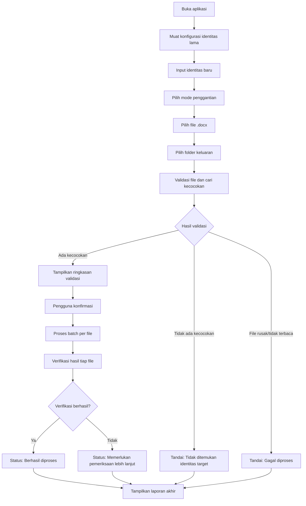

# Product Requirements Document (PRD)
# Word Identity Changer

## A. Informasi Dokumen

| Atribut | Nilai |
|---|---|
| Nama Produk | Word Identity Changer |
| Nama Dokumen | PRD Word Identity Changer |
| Versi PRD | 1.0 |
| Status Dokumen | Draft — menunggu konfirmasi pemangku kepentingan |
| Tanggal Penyusunan | 19 Oktober 2026 |
| Tujuan Dokumen | Menjadi acuan tunggal bagi UI/UX Designer dan Developer dalam merancang, membangun, dan menguji MVP Word Identity Changer, dengan ruang lingkup, kebutuhan fungsional, aturan bisnis, dan kriteria penerimaan yang jelas dan dapat ditindaklanjuti. |

---

## B. Ringkasan Produk

Word Identity Changer adalah aplikasi desktop berbasis Windows yang mengotomatisasi penggantian identitas mahasiswa — nama dan Nomor Induk Mahasiswa (NIM) — pada dokumen Microsoft Word (`.docx`). Aplikasi ini ditujukan bagi pengguna yang perlu menyesuaikan identitas pada beberapa dokumen tugas atau laporan yang memiliki isi sama, tanpa harus membuka dan mengedit setiap dokumen secara manual. Pengguna cukup mengatur identitas lama sebagai acuan, memasukkan identitas baru, memilih dokumen yang akan diproses, memeriksa hasil validasi kecocokan, lalu menjalankan proses penggantian secara batch.

Pada versi MVP, aplikasi hanya mendukung file `.docx`, memproses penggantian berbasis pencocokan teks persis terhadap identitas lama yang dikonfigurasi, dan selalu menghasilkan file baru tanpa mengubah dokumen sumber. Aplikasi tidak melakukan pengeditan isi dokumen secara umum, tidak mendukung format lain (PDF, `.doc`, `.docm`, dokumen hasil pindai), dan tidak menyertakan fitur akun, database, atau sinkronisasi cloud.

---

## C. Latar Belakang dan Permasalahan

Pengguna — khususnya mahasiswa — sering perlu mengirim atau mengumpulkan dokumen tugas dengan format dan isi yang sama kepada pihak lain (misalnya meneruskan template tugas kepada rekan sekelas), yang mengharuskan identitas (nama dan NIM) pada dokumen diganti sesuai pemilik dokumen yang baru. Proses ini umumnya dilakukan secara manual dengan membuka setiap file, mencari teks identitas, dan menggantinya satu per satu.

Permasalahan yang ingin diselesaikan oleh produk ini antara lain:

- Penggantian identitas secara manual pada banyak dokumen memakan waktu dan berulang.
- Risiko salah ketik nama atau NIM saat penggantian dilakukan manual.
- Waktu yang terbuang ketika pengguna harus membuka dan menyunting dokumen satu per satu.
- Risiko perubahan format atau isi dokumen secara tidak sengaja akibat proses edit manual, misalnya format font, spasi, atau struktur tabel yang berubah.

Tidak ada klaim statistik kuantitatif mengenai skala masalah ini yang digunakan dalam dokumen ini; pernyataan di atas disusun berdasarkan deskripsi kebutuhan produk, bukan data riset yang terverifikasi.

---

## D. Tujuan Produk dan Indikator Keberhasilan

Tujuan produk dirumuskan agar dapat diukur. Angka target di bawah ini merupakan **usulan awal** yang perlu dikonfirmasi oleh pemangku kepentingan sebelum dijadikan acuan formal pengujian penerimaan.

| Tujuan | Indikator Keberhasilan | Status Target |
|---|---|---|
| Ketepatan penggantian identitas target | Identitas lama yang cocok persis pada dokumen uji berhasil diganti tanpa mengubah teks non-target | Usulan awal — perlu konfirmasi |
| Keberhasilan pemrosesan batch | Dokumen dalam satu sesi dapat diproses secara independen; kegagalan satu file tidak menggagalkan file lain | Usulan awal — perlu konfirmasi |
| Keutuhan dokumen asli | Dokumen sumber tidak pernah ditimpa pada seluruh skenario pengujian | Keputusan final (bukan target terukur, melainkan aturan wajib) |
| Validitas file keluaran | File hasil dapat dibuka kembali pada Microsoft Word tanpa kerusakan pada sampel dokumen uji | Usulan awal — perlu konfirmasi |
| Kejelasan status hasil pemrosesan | Setiap dokumen memiliki status akhir yang eksplisit dan dapat dibaca pengguna nonteknis | Keputusan final (prinsip produk) |

Angka ambang (misalnya persentase keberhasilan minimum) belum ditetapkan dan harus diputuskan setelah pengujian terhadap dokumen `.docx` nyata (lihat bagian P).

---

## E. Target Pengguna dan Use Cases

### Target Pengguna Utama

- Mahasiswa yang perlu mengganti identitas (nama, NIM) pada dokumen tugas/laporan yang isinya sama dengan milik rekan lain, template dosen, atau arsip pribadi dari periode sebelumnya.
- Pengguna nonteknis yang tidak terbiasa menyunting dokumen Word secara manual untuk tugas berulang.

### Use Case Utama

1. **UC-01 — Mengganti identitas pada satu dokumen**: Pengguna memiliki satu file tugas berisi nama dan NIM milik orang lain (misalnya template dari teman), ingin menggantinya dengan identitas sendiri.
2. **UC-02 — Mengganti identitas pada beberapa dokumen sekaligus**: Pengguna memiliki beberapa file tugas dengan format sama (misalnya laporan mingguan praktikum), ingin mengganti identitas pada semua file dalam satu sesi.
3. **UC-03 — Mengganti sebagian identitas**: Pengguna hanya perlu mengganti nama saja atau NIM saja, misalnya karena identitas lain sudah benar.
4. **UC-04 — Memeriksa dokumen sebelum penggantian**: Pengguna ingin mengetahui jumlah kecocokan identitas lama pada tiap dokumen sebelum memutuskan melanjutkan proses.

Produk ini **tidak** mencakup sistem akun pengguna, autentikasi, penyimpanan cloud, atau fitur kolaborasi multi-pengguna, karena berada di luar kebutuhan MVP.

---

## F. Ruang Lingkup Produk

### In Scope (MVP)

- Konfigurasi dan penyimpanan identitas lama (nama dan NIM) pada aplikasi.
- Input identitas baru (nama dan/atau NIM) per sesi pemrosesan.
- Tiga mode penggantian: nama saja, NIM saja, atau nama dan NIM sekaligus.
- Pemilihan satu atau beberapa file `.docx` untuk diproses dalam satu sesi (batch).
- Pemilihan folder keluaran untuk menyimpan file hasil.
- Validasi file dan identifikasi jumlah kecocokan identitas lama sebelum proses.
- Pratinjau ringkasan hasil validasi dan permintaan konfirmasi pengguna sebelum penggantian dijalankan.
- Proses penggantian identitas pada dokumen `.docx`, dengan dokumen sumber tidak diubah.
- Pemrosesan batch yang independen per file (kegagalan satu file tidak menggagalkan file lain).
- Verifikasi hasil penggantian dan pelaporan status per file.
- Penanganan kesalahan dasar (file rusak, file tidak dapat diakses, dll).
- Packaging aplikasi menjadi `.exe` untuk Windows.

### Out of Scope (MVP)

- Dukungan format PDF.
- Dukungan format `.doc` dan `.docm`.
- OCR untuk dokumen hasil pemindaian.
- Penggantian identitas berbasis AI/model bahasa.
- Sinkronisasi cloud.
- Sistem akun dan database pengguna.
- Pengeditan isi dokumen secara umum di luar identitas target.

---

## G. Functional Requirements

| ID | Nama Fitur | Deskripsi | Alasan/Tujuan | Prioritas | Kriteria Penerimaan (ringkas) |
|---|---|---|---|---|---|
| FR-001 | Konfigurasi identitas lama | Pengguna dapat memasukkan nama lama dan NIM lama sebagai acuan pencarian | Menjadi dasar pencocokan teks target di dokumen | Must Have | Nama lama dan NIM lama dapat diisi dan disimpan |
| FR-002 | Penyimpanan konfigurasi | Konfigurasi identitas lama disimpan secara lokal dan dimuat otomatis saat aplikasi dibuka kembali | Menghindari pengisian ulang setiap sesi | Must Have | Konfigurasi tetap tersedia setelah aplikasi ditutup dan dibuka kembali |
| FR-003 | Input identitas baru | Pengguna memasukkan nama baru dan/atau NIM baru pada setiap sesi | Menentukan nilai pengganti | Must Have | Field identitas baru menerima input sesuai mode yang dipilih |
| FR-004 | Pemilihan mode penggantian | Pengguna memilih mode: nama saja, NIM saja, atau keduanya | Memberi fleksibilitas sesuai kebutuhan dokumen | Must Have | Mode terpilih menentukan field identitas mana yang diproses |
| FR-005 | Pemilihan banyak file | Pengguna dapat memilih satu atau beberapa file `.docx` sekaligus | Mendukung pemrosesan batch | Must Have | Dialog pemilihan file mendukung multi-select `.docx` |
| FR-006 | Pemilihan folder keluaran | Pengguna menentukan folder tempat file hasil disimpan | Mencegah penimpaan file sumber | Must Have | Folder keluaran dapat dipilih dan divalidasi dapat ditulis |
| FR-007 | Validasi file | Aplikasi memeriksa format dan keterbacaan setiap file sebelum pemrosesan | Mencegah kegagalan di tengah proses | Must Have | File tidak valid ditandai sebelum proses dimulai |
| FR-008 | Identifikasi kecocokan target | Aplikasi menghitung jumlah kemunculan identitas lama pada tiap file | Memberi informasi sebelum pengguna memutuskan | Must Have | Jumlah kecocokan per file ditampilkan secara akurat sesuai isi dokumen |
| FR-009 | Pratinjau hasil validasi | Aplikasi menampilkan ringkasan status dan jumlah kecocokan seluruh file sebelum proses | Mendukung keputusan pengguna | Must Have | Ringkasan mencakup seluruh file yang dipilih |
| FR-010 | Konfirmasi sebelum proses | Aplikasi meminta persetujuan eksplisit pengguna sebelum menjalankan penggantian | Mencegah proses tak disengaja | Must Have | Proses tidak berjalan tanpa konfirmasi pengguna |
| FR-011 | Penggantian identitas | Aplikasi mengganti teks identitas lama dengan identitas baru sesuai mode yang dipilih | Fungsi inti produk | Must Have | Hanya teks identitas target yang berubah; teks lain tetap sama |
| FR-012 | Pemrosesan batch | Aplikasi memproses seluruh file terpilih secara berurutan atau paralel, masing-masing independen | Efisiensi dan isolasi kegagalan | Must Have | Kegagalan satu file tidak menghentikan pemrosesan file lain |
| FR-013 | Penyimpanan file hasil | Aplikasi menyimpan hasil sebagai file baru pada folder keluaran | Menjaga dokumen sumber tetap utuh | Must Have | File sumber tidak berubah; file hasil tersimpan di folder keluaran |
| FR-014 | Verifikasi hasil | Aplikasi memeriksa ulang file hasil untuk memastikan identitas baru benar-benar tersemat | Menjamin keandalan hasil | Must Have | File hasil yang gagal verifikasi ditandai, bukan dianggap berhasil |
| FR-015 | Laporan status per file | Aplikasi menampilkan status akhir tiap file setelah proses selesai | Transparansi hasil kepada pengguna | Must Have | Setiap file memiliki satu status akhir yang jelas |
| FR-016 | Penanganan kesalahan | Aplikasi menangani file rusak, tidak dapat diakses, atau gagal diproses tanpa menghentikan aplikasi | Keandalan aplikasi | Must Have | Error pada satu file ditampilkan sebagai status, aplikasi tetap berjalan |
| FR-017 | Pembatalan proses | Pengguna dapat membatalkan proses batch yang sedang berjalan, jika secara teknis memungkinkan | Kendali pengguna atas proses panjang | Should Have | Tombol batal menghentikan pemrosesan file berikutnya; file yang sudah selesai tetap tersimpan |

---

## H. Business Rules

| ID | Aturan Bisnis |
|---|---|
| BR-001 | Identitas lama berasal dari konfigurasi aplikasi, bukan diinput ulang pada setiap sesi pemrosesan. |
| BR-002 | Penggantian hanya berlaku untuk identitas target (nama dan/atau NIM) sesuai konfigurasi identitas lama. |
| BR-003 | Mode penggantian yang dipilih pengguna menentukan field mana (nama, NIM, atau keduanya) yang diproses; field lain tidak disentuh. |
| BR-004 | NIM diperlakukan sebagai string/teks, bukan sebagai nilai numerik, agar angka nol di depan tidak hilang. |
| BR-005 | Dokumen sumber tidak boleh ditimpa dalam kondisi apa pun; hasil selalu disimpan sebagai file baru. |
| BR-006 | Dokumen yang tidak memiliki kecocokan identitas lama tidak boleh dilaporkan dengan status "berhasil diganti". |
| BR-007 | Dokumen yang ambigu (misalnya kecocokan ganda yang berpotensi salah target) atau gagal diverifikasi harus diberi peringatan dan status "memerlukan pemeriksaan lebih lanjut", bukan status gagal mutlak atau berhasil. |
| BR-008 | Proses penggantian tidak boleh mengubah teks lain yang bukan merupakan target identitas. |
| BR-009 | Pencocokan teks harus menghindari penggantian substring yang tidak disengaja. Contoh: NIM lama `12345` tidak boleh ikut mencocokkan dan mengubah bagian dari NIM lain seperti `9123456`, karena `12345` adalah substring dari `9123456`. Pencocokan harus memperlakukan NIM (dan idealnya nama) sebagai unit utuh, bukan potongan teks bebas, misalnya dengan memvalidasi batas kata/karakter di sekitar kecocokan. |

---

## I. Non-Functional Requirements

| Kategori | Kebutuhan | Status |
|---|---|---|
| Kemudahan penggunaan | Antarmuka dapat digunakan oleh pengguna nonteknis tanpa pelatihan khusus, dengan alur langkah yang jelas | Keputusan final (prinsip produk) |
| Kinerja pemrosesan | Target awal: pemrosesan satu dokumen berukuran wajar (berkisar puluhan halaman) selesai dalam hitungan detik | Usulan awal — perlu konfirmasi setelah pengujian dokumen nyata |
| Keandalan | Kegagalan pada satu file tidak boleh menghentikan atau merusak pemrosesan file lain dalam batch | Keputusan final |
| Keamanan dokumen lokal | Aplikasi tidak mengirim isi dokumen ke layanan eksternal mana pun; seluruh pemrosesan dilakukan secara lokal | Keputusan final (konsisten dengan cakupan MVP tanpa cloud) |
| Integritas data | Konfigurasi identitas lama dan hasil pemrosesan tidak boleh hilang atau korup akibat kegagalan aplikasi di tengah proses | Usulan awal — mekanisme penyimpanan perlu dirancang lebih lanjut |
| Kompatibilitas Windows | Aplikasi dapat dijalankan sebagai `.exe` pada versi Windows yang menjadi target dukungan (perlu ditetapkan versi minimum, misalnya Windows 10 ke atas) | Usulan awal — perlu konfirmasi versi Windows minimum |
| Kemudahan pemeliharaan | Struktur kode memisahkan logika UI, logika pencocokan/penggantian identitas, dan logika pemrosesan file, agar mudah diuji dan dikembangkan | Usulan awal — arsitektur detail menjadi tanggung jawab tim pengembang |
| Penanganan error | Setiap error ditangani dan ditampilkan sebagai pesan yang dapat dipahami pengguna nonteknis, tanpa aplikasi berhenti mendadak (crash) | Keputusan final (prinsip produk) |
| Aksesibilitas dasar | Antarmuka menggunakan ukuran teks dan kontras yang wajar, mendukung navigasi dasar dengan keyboard | Usulan awal — detail aksesibilitas perlu dikonfirmasi bersama UI/UX Designer |

---

## J. User Flow

### Alur Utama

1. Pengguna membuka aplikasi.
2. Aplikasi memuat konfigurasi identitas lama (nama lama dan NIM lama) yang tersimpan.
3. Pengguna memasukkan identitas baru (nama baru dan/atau NIM baru) sesuai kebutuhan.
4. Pengguna memilih mode penggantian: nama saja, NIM saja, atau keduanya.
5. Pengguna memilih satu atau beberapa file `.docx`.
6. Pengguna memilih folder keluaran untuk menyimpan hasil.
7. Aplikasi memvalidasi setiap file dan mencari jumlah kecocokan identitas lama.
8. Aplikasi menampilkan ringkasan hasil validasi (status dan jumlah kecocokan per file).
9. Pengguna memeriksa ringkasan dan memberikan konfirmasi untuk melanjutkan proses.
10. Aplikasi memproses dokumen satu per satu (batch), menyimpan hasil sebagai file baru.
11. Aplikasi memverifikasi hasil penggantian pada tiap file.
12. Aplikasi menampilkan laporan akhir berisi status setiap file.

### Alur Alternatif

- **Identitas tidak ditemukan**: Jika identitas lama tidak ditemukan pada suatu file, file tersebut ditandai status "Tidak ditemukan identitas target" pada tahap validasi (langkah 7–8) dan tidak diproses sebagai berhasil.
- **File rusak**: Jika file gagal dibuka/dibaca saat validasi, file ditandai "Gagal diproses" dengan keterangan penyebab, dan file lain tetap dilanjutkan.
- **File tidak dapat diakses**: Jika file terkunci, dihapus, atau tidak memiliki izin akses saat proses berjalan, file ditandai "Gagal diproses" tanpa menghentikan file lain dalam batch.
- **File keluaran sudah ada**: Jika nama file hasil sudah ada di folder keluaran, aplikasi meminta keputusan pengguna (timpa, ganti nama otomatis, atau lewati file tersebut) sebelum melanjutkan.
- **Verifikasi gagal**: Jika pasca-proses verifikasi menunjukkan identitas baru tidak tersemat dengan benar, file ditandai "Memerlukan pemeriksaan lebih lanjut", bukan "Berhasil diproses".

### Diagram Alur (Mermaid)

---

## K. Spesifikasi UI/UX

Spesifikasi berikut menjelaskan kebutuhan fungsional tampilan pada tingkat komponen, bukan desain visual rinci, karena desain detail baru dapat disusun setelah kebutuhan fungsional disepakati.

| Layar/Komponen | Kebutuhan |
|---|---|
| Halaman utama | Menyediakan akses ke konfigurasi identitas lama, form identitas baru, pemilihan file, dan tombol memulai proses; menampilkan status konfigurasi saat ini |
| Halaman konfigurasi identitas lama | Form input nama lama dan NIM lama, tombol simpan, validasi field tidak boleh kosong |
| Form identitas baru | Form input nama baru dan/atau NIM baru sesuai mode yang aktif; field dinonaktifkan sesuai mode yang tidak dipilih |
| Pilihan mode penggantian | Kontrol pilihan (misalnya radio button) untuk tiga mode: nama saja, NIM saja, nama dan NIM |
| Pemilihan dokumen | Dialog pemilihan file dengan dukungan multi-select, hanya menampilkan/menerima file `.docx`; daftar file terpilih dapat dilihat dan dihapus sebagian |
| Pemilihan folder keluaran | Dialog pemilihan folder sistem; menampilkan path folder yang dipilih |
| Panel pratinjau validasi | Tabel berisi nama file, status validasi, dan jumlah kecocokan identitas lama per file |
| Dialog konfirmasi | Ringkasan ringkas sebelum eksekusi: jumlah file, mode penggantian, dan peringatan jika ada file bermasalah; tombol lanjut dan batal |
| Indikator progres | Progres keseluruhan batch (misalnya n dari total file) dan status file yang sedang diproses |
| Halaman hasil pemrosesan | Tabel status akhir per file (berhasil, gagal, tidak ditemukan, perlu pemeriksaan), lokasi file hasil, dan opsi membuka folder keluaran |

Antarmuka harus sederhana, modern, dan konsisten, dengan prioritas kejelasan alur bagi pengguna nonteknis. Desain visual detail (palet warna, tipografi, tata letak piksel) berada di luar cakupan dokumen ini dan menjadi tanggung jawab UI/UX Designer setelah kebutuhan fungsional ini disetujui.

---

## L. Aturan Validasi

| Kondisi | Perilaku Sistem | Pesan kepada Pengguna | Sifat |
|---|---|---|---|
| Nama lama kosong | Mencegah konfigurasi disimpan | "Nama lama tidak boleh kosong." | Memblokir |
| NIM lama kosong | Mencegah konfigurasi disimpan | "NIM lama tidak boleh kosong." | Memblokir |
| Nama baru kosong saat mode membutuhkan nama | Mencegah proses dimulai | "Nama baru wajib diisi untuk mode yang dipilih." | Memblokir |
| NIM baru kosong saat mode membutuhkan NIM | Mencegah proses dimulai | "NIM baru wajib diisi untuk mode yang dipilih." | Memblokir |
| Identitas lama dan baru sama | Mengizinkan lanjut dengan peringatan (tidak ada perubahan berarti) | "Identitas baru sama dengan identitas lama. Tidak ada perubahan yang akan dilakukan." | Peringatan, dapat dilanjutkan |
| Tidak ada file dipilih | Mencegah proses dimulai | "Pilih minimal satu file .docx untuk diproses." | Memblokir |
| Format file tidak didukung | File ditolak dari daftar proses | "File [nama file] bukan format .docx dan tidak dapat diproses." | Memblokir untuk file tersebut |
| File rusak atau tidak dapat dibaca | File ditandai gagal, batch lain tetap lanjut | "File [nama file] tidak dapat dibaca atau rusak." | Memblokir untuk file tersebut |
| Identitas target tidak ditemukan | File ditandai "Tidak ditemukan identitas target", tidak diproses sebagai berhasil | "Identitas lama tidak ditemukan pada file [nama file]." | Peringatan, dapat dilanjutkan (file dilewati) |
| Terdapat lebih dari satu kecocokan | Menampilkan jumlah kecocokan, meminta konfirmasi pengguna | "Ditemukan [n] kecocokan pada file [nama file]. Periksa sebelum melanjutkan." | Peringatan, dapat dilanjutkan setelah konfirmasi |
| File keluaran sudah ada | Meminta keputusan pengguna sebelum menulis file | "File dengan nama yang sama sudah ada di folder keluaran. Timpa, ganti nama, atau lewati?" | Memblokir hingga pengguna memilih |
| Dokumen gagal diverifikasi | File ditandai "Memerlukan pemeriksaan lebih lanjut" | "Hasil pada file [nama file] tidak dapat diverifikasi sepenuhnya. Periksa secara manual." | Peringatan, tidak dianggap gagal mutlak |
| Salah satu file dalam batch gagal | File lain tetap diproses; laporan akhir mencantumkan file yang gagal | "[n] dari [total] file gagal diproses. Lihat laporan untuk detail." | Informasi, tidak memblokir file lain |

---

## M. Acceptance Criteria

| ID | Kriteria | Dapat Diuji Dengan |
|---|---|---|
| AC-001 | Konfigurasi identitas lama (nama dan NIM) dapat disimpan dan dimuat kembali saat aplikasi dibuka ulang | Simpan konfigurasi, tutup aplikasi, buka kembali, periksa nilai tetap sama |
| AC-002 | Mode penggantian nama saja mengganti hanya nama, NIM tidak berubah | Jalankan mode nama saja pada dokumen uji, bandingkan NIM sebelum dan sesudah |
| AC-003 | Mode penggantian NIM saja mengganti hanya NIM, nama tidak berubah | Jalankan mode NIM saja pada dokumen uji, bandingkan nama sebelum dan sesudah |
| AC-004 | Mode penggantian nama dan NIM mengganti keduanya secara benar | Jalankan mode gabungan, verifikasi kedua field berubah sesuai identitas baru |
| AC-005 | NIM dengan angka nol di depan tetap utuh setelah penggantian (tidak hilang atau berubah jadi numerik) | Uji NIM baru berawalan nol, periksa hasil pada dokumen keluaran |
| AC-006 | Beberapa file dapat diproses dalam satu sesi batch | Pilih 3 atau lebih file, jalankan satu sesi, verifikasi seluruh file diproses |
| AC-007 | Jumlah kecocokan identitas lama ditampilkan untuk setiap file sebelum pemrosesan dimulai | Pilih file dengan kecocokan berbeda-beda, periksa panel pratinjau validasi |
| AC-008 | File tanpa kecocokan identitas lama tidak dilaporkan dengan status "berhasil diganti" | Proses file tanpa identitas target, periksa status akhirnya |
| AC-009 | File sumber tidak berubah setelah proses, pada seluruh skenario pengujian | Bandingkan checksum/isi file sumber sebelum dan sesudah proses |
| AC-010 | File keluaran dapat dibuka kembali tanpa kerusakan pada Microsoft Word | Buka file hasil pada Microsoft Word, pastikan tidak ada pesan kerusakan |
| AC-011 | Identitas target pada file hasil dapat diverifikasi sesuai identitas baru yang diinput | Baca ulang isi file hasil, cocokkan dengan identitas baru |
| AC-012 | Kegagalan pada satu file dalam batch tidak menghentikan pemrosesan file lain | Sertakan satu file rusak dalam batch, verifikasi file lain tetap diproses |
| AC-013 | Elemen non-target (teks, format, struktur) pada dokumen yang didukung tetap terjaga setelah proses | Bandingkan bagian dokumen di luar identitas target sebelum dan sesudah proses |
| AC-014 | Aplikasi dapat dijalankan sebagai file `.exe` pada lingkungan Windows yang ditetapkan sebagai target dukungan | Jalankan hasil build `.exe` pada lingkungan Windows target, verifikasi seluruh alur utama berfungsi |

---

## N. Risiko dan Mitigasi Teknis

| Risiko | Penjelasan | Mitigasi |
|---|---|---|
| Teks terpecah menjadi beberapa Word runs | DOCX menyimpan teks dalam elemen `run` yang dapat terpecah akibat format berbeda (bold, warna, dll.), sehingga teks identitas dapat terbagi lintas beberapa run dan tidak terdeteksi oleh pencocokan sederhana | Perlu strategi pencocokan yang mempertimbangkan penggabungan teks antar-run dalam satu paragraf sebelum pencarian, diuji terhadap dokumen nyata; bukan diasumsikan selalu berhasil |
| Identitas dalam tabel | Identitas dapat berada di dalam sel tabel, yang memiliki struktur XML berbeda dari paragraf biasa | Pastikan logika pencarian mencakup elemen tabel, diuji secara eksplisit sebagai skenario terpisah |
| Identitas dalam header dan footer | Header/footer disimpan sebagai bagian XML terpisah dari isi utama dokumen | Perlu dipastikan apakah header/footer termasuk cakupan MVP; jika termasuk, logika pencarian harus mencakup bagian ini secara eksplisit dan diuji |
| Identitas dalam text box, footnote, atau elemen khusus | Elemen ini memiliki struktur XML yang lebih kompleks dan berpotensi tidak terbaca oleh pustaka standar seperti `python-docx` | Tandai sebagai area yang perlu diuji; jika tidak didukung penuh, dokumen dengan elemen ini harus ditandai "memerlukan pemeriksaan lebih lanjut", bukan diklaim berhasil |
| Kemunculan identitas yang ambigu | Nama atau NIM lama dapat muncul sebagai bagian dari teks lain yang tidak dimaksudkan sebagai identitas (misalnya nama yang sama dengan nama orang lain dalam dokumen) | Terapkan pencocokan berbasis batas kata/karakter (lihat BR-009), serta beri peringatan dan opsi tinjau manual saat kecocokan lebih dari satu kali ditemukan |
| Perubahan format yang tidak disengaja | Manipulasi XML atau penulisan ulang run dapat mengubah format (font, ukuran, spasi) secara tidak sengaja | Lakukan pengujian pembandingan format sebelum dan sesudah proses pada berbagai jenis dokumen uji; dokumentasikan keterbatasan yang ditemukan |
| Dokumen rusak atau terenkripsi | File `.docx` dapat rusak, berisi proteksi password, atau menggunakan enkripsi yang mencegah pembacaan otomatis | Validasi awal mendeteksi file yang tidak dapat dibuka dan menandainya "Gagal diproses" tanpa menghentikan proses file lain |
| Konflik nama file keluaran | File dengan nama sama mungkin sudah ada di folder keluaran dari sesi sebelumnya | Terapkan aturan validasi file keluaran sudah ada (lihat bagian L), beri pilihan eksplisit kepada pengguna |

Tidak semua elemen di atas dapat diasumsikan sudah pasti didukung penuh pada MVP; cakupan dukungan final (misalnya header/footer, text box) harus ditetapkan setelah pemeriksaan template DOCX nyata (lihat bagian Q, tahap 2).

---

## O. Rencana Pengujian MVP

| Skenario Uji | Tujuan |
|---|---|
| Dokumen dengan identitas di paragraf biasa | Memastikan pencocokan dan penggantian dasar berfungsi benar |
| Dokumen dengan identitas di dalam tabel | Memastikan logika pencarian mencakup struktur tabel |
| Dokumen dengan beberapa kemunculan identitas | Memastikan seluruh kemunculan terdeteksi dan diganti secara konsisten |
| Dokumen dengan NIM berawalan nol | Memastikan nol di depan tidak hilang pada hasil |
| Dokumen tanpa identitas target | Memastikan status "Tidak ditemukan identitas target" muncul, bukan "berhasil" |
| Dokumen rusak | Memastikan aplikasi menandai file gagal tanpa crash dan tanpa menghentikan file lain |
| Beberapa file dengan hasil berbeda dalam satu batch | Memastikan isolasi kegagalan antar-file berfungsi sesuai BR dan FR-012 |
| Dokumen dengan elemen khusus (text box, footnote, header/footer) | Memastikan sistem menandai dokumen ini sesuai hasil pengujian nyata, bukan mengasumsikan dukungan penuh |
| Verifikasi dokumen asli tidak berubah | Membandingkan file sumber sebelum dan sesudah proses untuk memastikan tidak ada perubahan |

Seluruh skenario di atas merupakan rencana pengujian yang belum dilaksanakan pada saat penyusunan dokumen ini. Hasil pengujian aktual akan menjadi dasar untuk memperbarui status target pada bagian D dan I, serta cakupan dukungan pada bagian N.

---

## P. Asumsi, Batasan, dan Pertanyaan Terbuka

### Keputusan yang Sudah Final

- Identitas lama berasal dari konfigurasi aplikasi, bukan input ulang per sesi.
- MVP hanya mendukung `.docx`.
- Dokumen sumber tidak pernah ditimpa; hasil selalu berupa file baru.
- NIM diperlakukan sebagai string, bukan angka.
- Aplikasi dibangun untuk platform Windows, dipaketkan sebagai `.exe`.

### Asumsi Sementara

- Pengguna menjalankan aplikasi pada komputer dengan akses baca/tulis penuh ke folder dokumen dan folder keluaran yang dipilih.
- Dokumen uji awal yang tersedia mewakili variasi struktur dokumen yang umum digunakan pengguna (paragraf dan tabel); elemen lebih kompleks (text box, footnote) akan diuji terpisah.
- Target performa dan ambang keberhasilan pada bagian D dan I bersifat awal dan dapat berubah setelah pengujian.

### Hal yang Perlu Dikonfirmasi

- Versi minimum Windows yang didukung secara resmi.
- Apakah header dan footer termasuk dalam cakupan pencarian/penggantian MVP.
- Angka target performa dan tingkat keberhasilan yang dianggap dapat diterima.
- Perilaku default saat file keluaran sudah ada (timpa otomatis, selalu tanya, atau selalu ganti nama).

### Hal yang Baru Dapat Dipastikan Setelah Pengujian Dokumen `.docx` Nyata

- Cakupan dukungan elemen khusus (text box, footnote, elemen tertanam lainnya).
- Tingkat keandalan pencocokan teks yang terpecah lintas Word runs.
- Konsistensi format dokumen hasil dibandingkan dokumen sumber pada berbagai template nyata yang digunakan pengguna.

---

## Q. Rekomendasi Tahapan Pengembangan

1. **Finalisasi kebutuhan produk** — menyepakati seluruh poin pada bagian P yang masih memerlukan konfirmasi, serta angka target pada bagian D dan I.
2. **Pemeriksaan template DOCX nyata** — mengumpulkan sampel dokumen tugas/laporan nyata untuk memahami variasi struktur (paragraf, tabel, header/footer, elemen khusus).
3. **Perancangan wireframe dan UI/UX** — menyusun alur dan tata letak layar berdasarkan spesifikasi pada bagian K, setelah kebutuhan fungsional disepakati.
4. **Implementasi validasi dan pencocokan identitas** — membangun logika pencarian identitas lama termasuk penanganan run terpecah dan pencegahan substring tidak disengaja (BR-009).
5. **Implementasi pemrosesan dokumen** — membangun logika penggantian dan penyimpanan file hasil tanpa mengubah dokumen sumber.
6. **Integrasi antarmuka dan pemrosesan batch** — menghubungkan UI dengan logika pemrosesan, termasuk indikator progres dan isolasi kegagalan antar-file.
7. **Pengujian dan verifikasi** — menjalankan seluruh skenario pada bagian O terhadap dokumen uji nyata.
8. **Packaging menjadi `.exe`** — membangun paket distribusi menggunakan PyInstaller dan menguji pada lingkungan Windows target.

Estimasi durasi untuk setiap tahap tidak disertakan dalam dokumen ini karena belum tersedia informasi kapasitas tim pengembang.

---

## Lampiran: Rekomendasi Teknologi

| Komponen | Teknologi | Alasan Pemilihan |
|---|---|---|
| Bahasa pemrograman | Python | Memiliki ekosistem pustaka matang untuk pemrosesan dokumen Office dan pengembangan desktop, serta mendukung packaging menjadi `.exe` |
| Framework antarmuka desktop | PySide6 | Framework GUI desktop yang stabil, mendukung Windows, dan memiliki komponen UI standar yang sesuai kebutuhan aplikasi ini |
| Pemrosesan dokumen | `python-docx`, dengan manipulasi XML DOCX terkontrol bila diperlukan | `python-docx` menyediakan akses terstruktur ke paragraf, run, dan tabel; manipulasi XML langsung diperlukan untuk kasus yang tidak dijangkau `python-docx`, seperti elemen tertentu pada header/footer atau text box |
| Packaging | PyInstaller | Alat yang umum digunakan untuk mengemas aplikasi Python menjadi `.exe` mandiri pada Windows |

Rekomendasi ini merupakan titik awal yang dapat dievaluasi ulang oleh tim pengembang, bukan batasan mutlak. Tidak ada jaminan bahwa seluruh format dan elemen Word dapat dipertahankan 100% secara otomatis; kompatibilitas harus diverifikasi melalui pengujian terhadap dokumen `.docx` nyata sebagaimana dijelaskan pada bagian N dan O.

---

*Akhir dokumen.*
